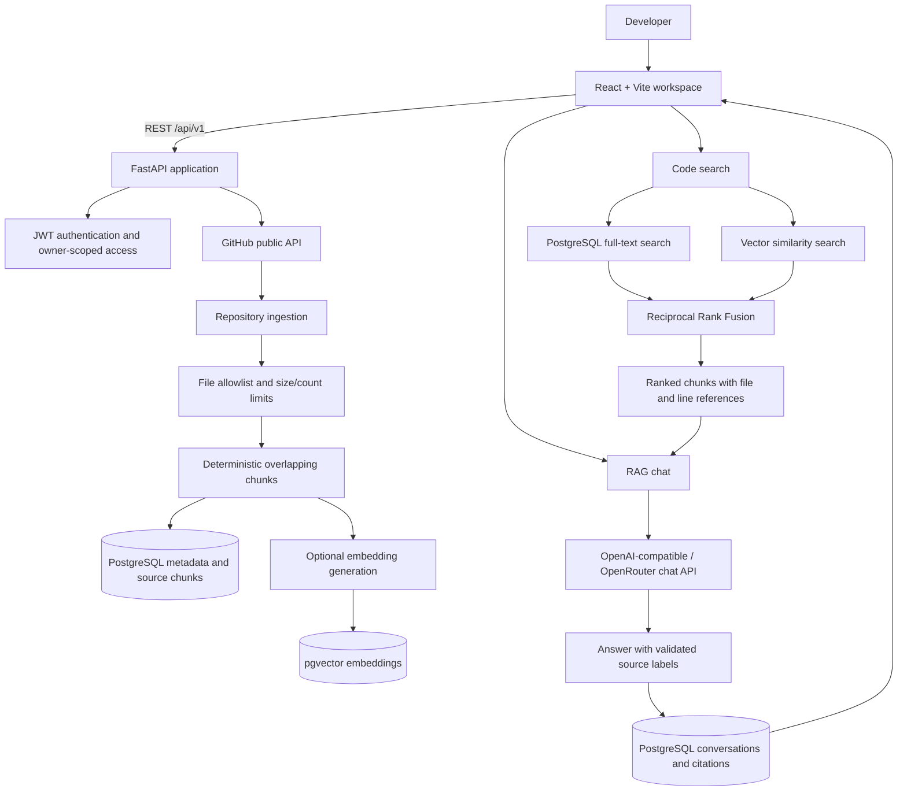

# RepoLens

**GitHub Codebase Intelligence Assistant**

RepoLens helps developers understand public GitHub repositories by browsing source files, indexing a commit snapshot, searching code with keyword and semantic retrieval, and asking questions through retrieval-augmented generation (RAG). Answers include source references that link back to repository files and line ranges.

---

## What it does

- **Explore repositories:** inspect a public GitHub repository, browse directories and files, and select a branch.
- **Index a snapshot:** fetch bounded, allowlisted text files from a specific commit; split source into deterministic overlapping chunks and retain file paths, line ranges, and content hashes.
- **Search code:** run PostgreSQL full-text keyword search, pgvector cosine-similarity search, or hybrid retrieval with Reciprocal Rank Fusion (RRF).
- **Ask codebase questions:** retrieve relevant chunks and pass bounded source context to an OpenAI-compatible chat provider. Answers carry source citations linked to the original code.
- **Keep workspaces:** save repositories, indexing/embedding job states, and chat conversations in PostgreSQL, scoped to the authenticated user.
- **Evaluate retrieval:** measure Recall@k, MRR, nDCG@k, citation validity, citation support precision, and coverage using an offline evaluation dataset.

RepoLens indexes source text for analysis. It does **not** execute repository code or train a model.

## How it works



### Main processing stages

1. **Connect:** the backend validates a GitHub repository URL and retrieves public repository metadata and branches.
2. **Select a snapshot:** the chosen branch is resolved to a commit SHA. Indexing records that commit so results remain attributable to a known source version.
3. **Ingest safely:** the GitHub integration reads only supported, allowlisted text files within configured limits. Source is never run.
4. **Chunk and persist:** source is divided into deterministic overlapping chunks with file path, line range, and content hash metadata.
5. **Embed when configured:** an embedding provider converts chunks to vectors. Keyword search does not depend on embeddings.
6. **Retrieve:** keyword and semantic rankings can be combined with Reciprocal Rank Fusion. Results are scoped to the current owner, repository, commit, and active embedding configuration.
7. **Generate a grounded answer:** RAG chat receives bounded retrieved source context and selected conversation history. It is instructed to treat code/comments as untrusted evidence and cite supplied source labels.
8. **Save the conversation:** user messages, assistant responses, and source-citation metadata are stored for later review.

## Features

### Repository workspace

- Inspect a public GitHub repository from its URL.
- Save repositories to the signed-in user's workspace.
- Browse public repository directory contents.
- List branches and select the branch snapshot to index.
- View indexing and embedding job progress.

### Source indexing

- Commit-specific source snapshots.
- Allowlisted text-file ingestion with bounded processing.
- Deterministic chunking with overlap.
- File paths, source line ranges, and content hashes retained with chunks.
- Source-only processing; repository code is never executed.

### Code search

| Mode | Behavior | Configuration |
|---|---|---|
| Keyword | PostgreSQL full-text search | Works after source indexing; no embedding key required |
| Semantic | pgvector cosine-similarity retrieval | Requires embeddings for the selected snapshot |
| Hybrid | Combines keyword and semantic rankings using RRF | Requires compatible embeddings for the selected snapshot |

Search results include ranked source snippets and repository/file/line context so developers can inspect the original code.

### RepoLens AI chat

- Ask questions about the currently indexed repository snapshot.
- Retrieve relevant source chunks before generating an answer.
- Include bounded context and recent conversation history.
- Return source citations with file and line links.
- Save conversations and citation metadata in PostgreSQL.
- Return a deterministic no-evidence response when retrieval finds no relevant source.
- Validate citation labels and mark unknown labels as unavailable rather than silently mapping them to a source.

The LLM is used to explain retrieved code; it is not used to fabricate repository contents. Generated answers can still be wrong, so verify important statements against their citations.

### Retrieval evaluation

The offline evaluation utility supports:

- Recall@k
- Mean Reciprocal Rank (MRR)
- nDCG@k
- Citation validity
- Citation support precision
- Citation coverage
- Unknown citation reporting and per-query results

Evaluation input uses JSONL records containing queries, human-labelled relevant chunks, retrieved chunk IDs, known source labels, cited labels, and human-reviewed supporting labels. The checked-in sample is illustrative, not a real quality benchmark.

## Technology stack

| Area | Technologies |
|---|---|
| Frontend | React, Vite, JavaScript / JSX, Tailwind CSS |
| Frontend testing | Vitest |
| Backend API | Python, FastAPI, Pydantic Settings |
| Data access | SQLAlchemy 2 |
| Database migrations | Alembic |
| Database | PostgreSQL 16+, pgvector, PostgreSQL full-text search |
| Retrieval | Deterministic source chunking, vector cosine similarity, RRF |
| LLM integration | OpenAI-compatible API, OpenRouter configuration |
| Authentication | Argon2 password hashing, signed JWT access tokens |
| Backend testing | pytest |
| CI | GitHub Actions |

## Project structure

The tree below shows the main source areas and their responsibilities.

```text
RepoLens/
├── backend/
│   ├── app/
│   │   ├── api/
│   │   │   ├── routes/             # Versioned REST endpoints
│   │   │   ├── schemas/            # Request and response schemas
│   │   │   ├── dependencies.py     # Shared API dependencies
│   │   │   └── router.py           # API route composition
│   │   ├── core/                   # Settings and security configuration
│   │   ├── db/                     # SQLAlchemy session and schema checks
│   │   ├── evaluation/             # Retrieval and citation evaluation
│   │   ├── models/                 # User, repository, chunks, jobs and chat models
│   │   ├── services/               # GitHub, indexing, embeddings, retrieval and chat
│   │   └── main.py                 # FastAPI application entry point
│   ├── evaluation/
│   │   └── examples/               # Example JSONL evaluation input
│   ├── migrations/                 # Alembic revisions
│   ├── tests/                      # Backend unit and integration tests
│   ├── .env.example                # Backend configuration template
│   ├── alembic.ini
│   └── requirements.txt
├── frontend/
│   ├── src/
│   │   ├── components/             # Reusable interface components
│   │   ├── pages/                  # Workspace and code explorer pages
│   │   ├── lib/                    # API client and GitHub URL helpers
│   │   └── styles.css              # Global application styles
│   ├── .env.example                # Frontend configuration template
│   ├── package.json
│   ├── tailwind.config.js
│   ├── vite.config.js
│   └── vitest.config.js
├── docs/                           # Architecture, implementation and phase notes
├── scripts/
│   └── package_release.py          # Source archive builder and validator
├── .github/
│   └── workflows/                  # CI workflow
├── SECURITY.md
└── README.md
```

## Data model

PostgreSQL is the persistent workspace store. The main entities include:

| Entity | Purpose |
|---|---|
| User | Account identity, password hash, and ownership boundary |
| Repository | Saved public repository, owner, selected branch, and indexed commit metadata |
| Indexing job | Source indexing state, counts, errors, and snapshot information |
| Repository chunk | Source text, file path, line range, content hash, and commit association |
| Chunk embedding | Vector representation plus provider/model/dimension metadata |
| Chat conversation | Conversation associated with an authenticated user and saved repository |
| Chat message | User/assistant message, timestamp, and stored citation metadata |

Migrations are managed with Alembic. The pgvector extension must be installed on the PostgreSQL server and enabled in the RepoLens database before applying migrations that create vector storage.

## API overview

All application routes are versioned under `/api/v1`. The development API schema is available at `/docs`.

| Area | Endpoint | Purpose |
|---|---|---|
| Health | `GET /health/live`, `GET /health/ready` | Liveness and database readiness |
| Authentication | `POST /auth/register`, `POST /auth/login`, `GET /auth/me` | Account and session operations |
| Repository | `POST /repositories/inspect` | Inspect a public GitHub repository |
| Saved workspace | `POST /repositories/saved`, `GET /repositories/saved`, `DELETE /repositories/saved/{repository_id}` | Save and manage owned repositories |
| Branches | `GET /repositories/saved/{repository_id}/branches`, `PATCH /repositories/saved/{repository_id}/branch` | List and select branches |
| Indexing | `POST /repositories/saved/{repository_id}/index`, `GET /repositories/saved/{repository_id}/jobs/{job_id}` | Queue and inspect source indexing |
| Embeddings | `POST /repositories/saved/{repository_id}/embeddings` | Generate configured embeddings |
| Search | `POST /repositories/saved/{repository_id}/search` | Keyword, semantic, or hybrid search |
| Chat | `POST /repositories/saved/{repository_id}/chat` | Ask a repository-grounded question |
| Conversations | `GET /repositories/saved/{repository_id}/conversations`, `GET /repositories/saved/{repository_id}/conversations/{conversation_id}` | Read saved conversation history |
| Public contents | `GET /repositories/{owner}/{repository}/contents` | Browse public repository contents |

Protected workspace operations require authentication and verify resource ownership. The OpenAPI schema in the running backend provides exact request and response fields.

## Local development

### Prerequisites

- Python 3.12 or newer
- Node.js 22.12 or newer and npm
- PostgreSQL 16 or newer
- pgvector installed for the PostgreSQL server version
- Git

RepoLens currently uses a local Python/PostgreSQL setup; Docker is not required.

### 1. Clone the repository

```bash
git clone https://github.com/digvijay1129/RepoLens.git
cd RepoLens
```

### 2. Create the database

Connect to PostgreSQL as an administrator and create a local application user and database. Replace the example password with a strong local-only value.

```sql
CREATE USER repolens_user WITH PASSWORD 'replace_with_a_strong_local_password';
CREATE DATABASE repolens OWNER repolens_user;
```

Install the pgvector server extension compatible with your PostgreSQL installation, connect to the new database, and enable it:

```sql
CREATE EXTENSION IF NOT EXISTS vector;
```

### 3. Configure and run the backend

From the repository root, using Windows PowerShell:

```powershell
cd backend
py -3.12 -m venv .venv
.\.venv\Scripts\Activate.ps1
python -m pip install --upgrade pip
pip install -r requirements.txt
Copy-Item .env.example .env
```

Edit `backend/.env` and configure at minimum:

- `DATABASE_URL` — connection string for the local RepoLens PostgreSQL database.
- `JWT_SECRET_KEY` — unique random signing secret of at least 32 bytes.

Generate a local JWT secret:

```powershell
python -c "import secrets; print(secrets.token_urlsafe(48))"
```

Apply and verify database migrations:

```powershell
alembic upgrade head
alembic current
python -m app.db.schema_check
```

Start the API:

```powershell
uvicorn app.main:app --reload
```

Backend development URLs:

- API: `http://127.0.0.1:8000`
- OpenAPI docs: `http://127.0.0.1:8000/docs`
- Liveness: `http://127.0.0.1:8000/api/v1/health/live`
- Readiness: `http://127.0.0.1:8000/api/v1/health/ready`

### 4. Configure and run the frontend

Open a second terminal at the repository root:

```powershell
cd frontend
npm ci
Copy-Item .env.example .env
npm test
npm run build
npm run dev
```

The frontend API base URL defaults to `http://127.0.0.1:8000`. Override it with `VITE_API_BASE_URL` in `frontend/.env` when your backend uses another origin. Open the local URL printed by Vite (normally `http://localhost:5173`).

### 5. Configure optional AI services

LLM chat and embedding generation are optional. The backend uses OpenRouter-compatible configuration in `backend/.env`:

```dotenv
OPENROUTER_API_KEY=your_private_api_key
OPENROUTER_BASE_URL=https://openrouter.ai/api/v1
OPENROUTER_CHAT_MODEL=your_supported_chat_model
OPENROUTER_EMBEDDING_MODEL=your_supported_embedding_model
OPENROUTER_HTTP_REFERER=http://localhost:5173
OPENROUTER_APP_TITLE=RepoLens

LLM_ENABLED=true
EMBEDDINGS_ENABLED=true
EMBEDDINGS_DIMENSIONS=1536
```

Use model identifiers supported by your selected provider and ensure the embedding dimensions match the configured vector column. The values above are configuration examples; check the provider's current model catalog before use.

- **Keyword search:** does not need an embedding provider.
- **Semantic/hybrid search:** requires embeddings generated with the active provider, model, and dimensions.
- **RAG chat:** requires an enabled chat provider. Chat can use keyword retrieval when embeddings are disabled.

Keep provider keys in backend-only environment variables. Do not put secrets in `VITE_*` variables or commit `.env` files. Provider calls may incur costs. Retrieved code excerpts and bounded chat history are sent to the configured model provider; only index code you are authorized to share and review the provider's privacy and retention terms.

## Testing and evaluation

Run backend checks from an activated backend environment:

```powershell
cd backend
pytest
python -m app.db.schema_check
```

Run frontend checks:

```powershell
cd frontend
npm test
npm run build
```

Run the offline retrieval evaluation from `backend/`:

```powershell
python -m app.evaluation.evaluate --input evaluation/examples/openrouter_rag_run.jsonl --k 5 --output evaluation/report.json
```

The checked-in JSONL input is illustrative. For meaningful evaluation, use representative queries and human-reviewed relevant chunks and citation-support labels.

## Security and scope

- Passwords are hashed with Argon2; plaintext passwords are not stored.
- Access uses signed JWT tokens with issuer, audience, and expiry claims.
- Saved repositories, indexing jobs, conversations, and workspace operations are scoped to the authenticated user.
- Repository URLs are restricted to HTTPS on the GitHub host; backend GitHub API requests use the fixed GitHub API origin.
- Source indexing is bounded and allowlisted; repository code is not executed.
- Retrieved source and conversation text are treated as untrusted context in RAG prompts.
- OpenRouter credentials stay on the backend and should never be exposed to the browser.

Current scope limitations:

- Only public GitHub repositories are supported; private repository OAuth/access is not implemented.
- No repository code execution, Docker workflow, or TypeScript application is included.
- Chat and embeddings depend on external provider configuration and availability.
- Citation grounding improves traceability but does not guarantee that generated answers are always correct.
- Production hosting is not configured by this repository's deployment-preparation work. A successful test run does not itself establish production readiness.

See [SECURITY.md](SECURITY.md) for the project security policy.

## Related technical documentation

Detailed implementation notes are maintained in `docs/`:

- [Phase 1 — Project foundation](docs/PHASE_1.md)
- [Phase 1B — Frontend and URL validation](docs/PHASE_1B.md)
- [Phase 2A — Database foundation](docs/PHASE_2A.md)
- [Phase 2B — Live database and schema verification](docs/PHASE_2B.md)
- [Phase 3A — GitHub repository browsing](docs/PHASE_3A.md)
- [Phase 3B — Authentication and saved repositories](docs/PHASE_3B.md)
- [Phase 4A — Source indexing](docs/PHASE_4A.md)
- [Phase 4B — Embeddings](docs/PHASE_4B.md)
- [Phase 5 — Hybrid retrieval and citations](docs/PHASE_5.md)
- [Phase 6 — RAG chat and conversation history](docs/PHASE_6.md)
- [Phase 7 — OpenRouter integration and evaluation](docs/PHASE_7.md)
- [Phase 8 — Deployment preparation and security](docs/PHASE_8.md)
